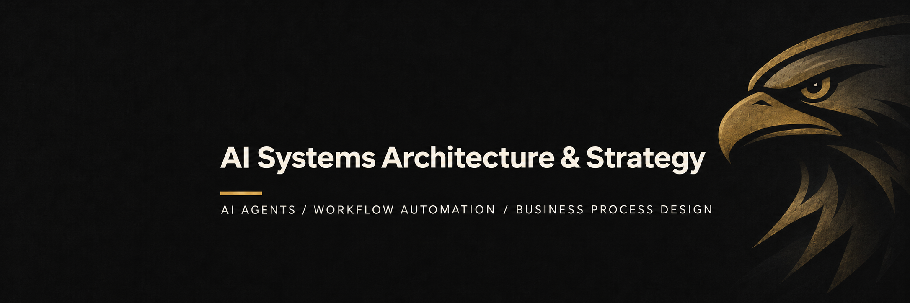
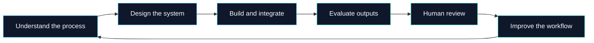

  
  
  
<strong>Entrepreneurship &amp; Economics at Southern Miss · Hattiesburg, Mississippi</strong>

  

    
    
    
  

## About me

I've designed and built 20+ AI systems across sales, HR, content, and operations. I co-founded Forerunners Tech Labs in high school, led client discovery and delivery, and now study Entrepreneurship and Economics at the University of Southern Mississippi.

My work starts with process diagnosis: where does the work stall, what information is missing, and which decisions need a person? Then I design and build the system, connect the tools it needs, and test whether it solves the problem.

Currently exploring company knowledge systems, approval-based agents, and machine learning through projects.

## Selected projects

<table>
<tr>
<td width="33%" valign="top">
<h3>01 / Short-video recommender</h3>

A two-tower retrieval model trained on 12.5M KuaiRec watch records. An ML learning project with baselines, bias checks, and documented limitations.

<strong>0.317 recall@10</strong> vs. 0.248 for popularity, roughly a 28% improvement. Level with the similar-user counting baseline at 0.316.

<a href="https://github.com/abdullahautomates/kuairec-two-tower">Code, results &amp; reproducible experiments →</a>

</td>
<td width="33%" valign="top">
<h3>02 / ParkLens</h3>

A campus parking assistant built with a team of three at Southern Miss's Hatchathon. Class schedule + permit + available spaces → one lot and Google Maps directions.

Computer vision counts open spaces from <strong>recorded campus footage</strong>. Voice interaction runs on ElevenLabs.

<a href="projects/parklens.md">Project overview →</a>

</td>
<td width="33%" valign="top">
<h3>03 / N3OS</h3>

A company second brain I designed and built as co-founder and lead developer. A live knowledge layer connects company information, answers with citations, and turns SOPs into repeatable skills.

<strong>Human approval before execution.</strong> Deployed proof of concept on fictional demo data.

<a href="projects/n3os.md">Concept &amp; workflow →</a>

</td>
</tr>
</table>

## Systems built for clients

Built during my work at Forerunners Tech Labs. These are summaries of the public case studies; client implementations remain private.

| System | What it does | Reported result |
| :--- | :--- | :--- |
| [Fasset · Sales](https://abdullahmustafa.site/fasset-case-study.html) | Lead intake → research → personalized email → sales workflow | First email in **10 seconds**, down from ~6 hours; **90% less manual sales effort** |
| [ARD Global · HR](https://abdullahmustafa.site/ard-global-case-study.html) | WhatsApp policy support, leave requests, and attendance in English, Urdu, and Punjabi | **85% less HR query handling time**; **70% less leave processing time** |
| [Axiom Strat Capital · Video](https://abdullahmustafa.site/axiom-case-study.html) | Intake → custom script → synthesized voice → rendered sales video | A personalized **30-minute video in 15 minutes**; **98% less production time** |

[More public case studies on my portfolio →](https://abdullahmustafa.site)

## How I work

<table>
<tr>
<td width="33%" valign="top"><h3>Diagnose</h3>
Map the process, talk to the people doing the work, and identify the delay or missing decision.
</td>
<td width="33%" valign="top"><h3>Design &amp; build</h3>
Connect the data, tools, and agent actions. Put human approval where judgment matters.
</td>
<td width="33%" valign="top"><h3>Evaluate</h3>
Check outputs against the original problem. Compare baselines, inspect failures, and document limits.
</td>
</tr>
</table>

## Tools & focus

**Systems:** process mapping · AI agents · RAG & knowledge systems · workflow automation · data enrichment · human approval workflows

**AI development**

**Workflow automation**

**Data & operations**

**Channels & delivery**

## Beyond the builds

- BSBA in Entrepreneurship, second major in Economics at Southern Miss. Expected graduation: December 2029.
- Full tuition and housing scholarship; Student Government Association Freshman Council member.
- From Lahore, Pakistan; now based in Hattiesburg, Mississippi.
- English, Urdu, and Punjabi.

GitHub activity

 

---

**Looking for a Summer 2027 internship** in AI solutions, product, or business operations. Available May 24–August 14, 2027.

[LinkedIn](https://www.linkedin.com/in/abdullah-mustafa06/) · [Email](mailto:abdullah.mustafa.1106@gmail.com) · [Portfolio](https://abdullahmustafa.site)
