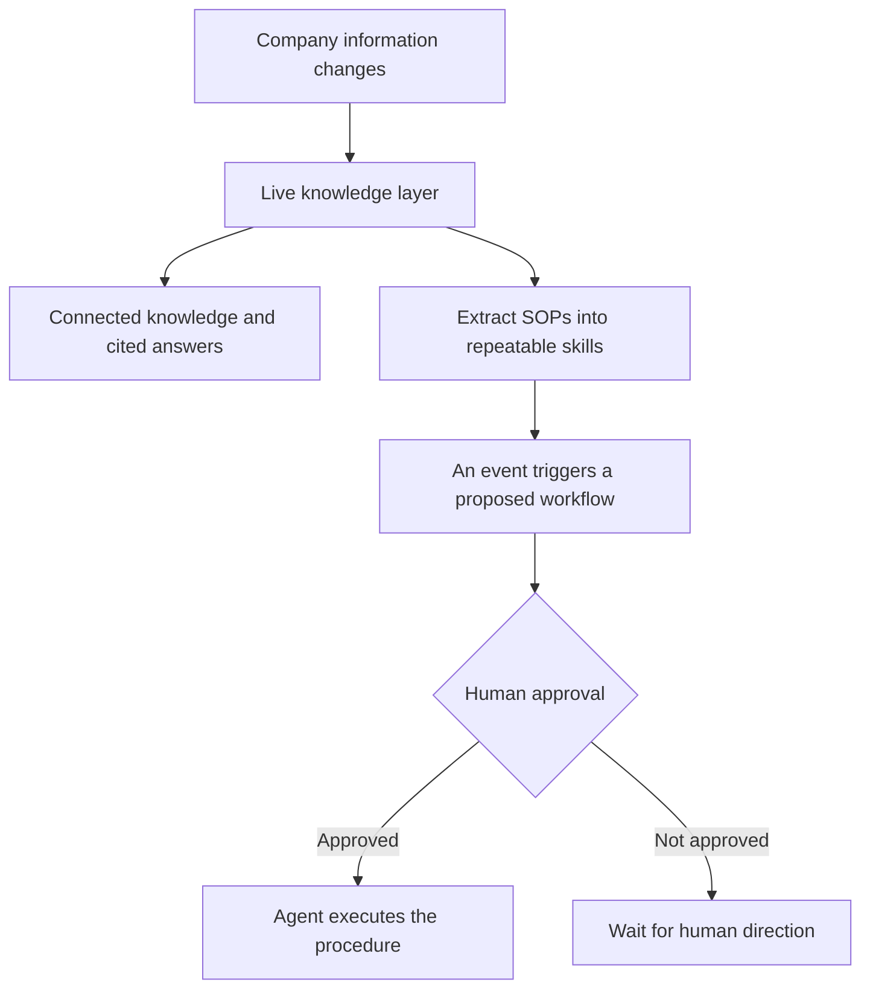

# N3OS

A company second brain, designed and built by Abdullah Mustafa as co-founder and lead developer. Built in July 2026; deployed as a proof of concept using fictional demo data.

## The idea

Company knowledge is spread across documents, messages, and procedures. N3OS connects that information in a live knowledge layer, answers questions with source citations, and adds an agent that can act after a person approves.

## From knowledge to action

## Example workflow

A CEO emails HR about offboarding an employee and copies N3OS. The system identifies the relevant procedure from company knowledge and proposes the offboarding steps. HR reviews the plan. Execution waits for approval.

This illustrates the intended workflow. The proof of concept uses fictional company data; it has no claimed production customers or usage metrics.

The source repository remains private.

[Back to profile](../README.md)
